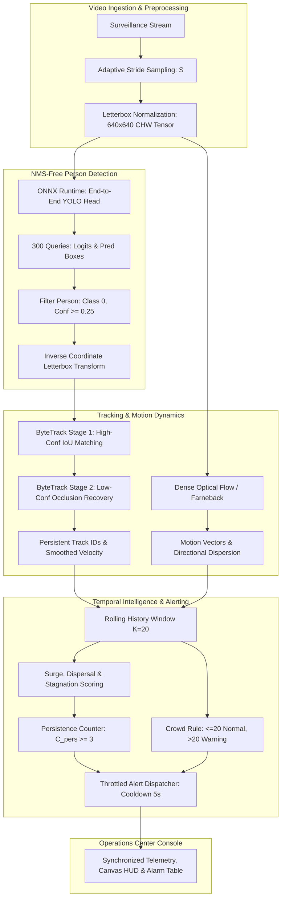

# VisionSense AI Crowd Anomaly Detection System
## Turnkey IEEE Research Paper Input Package for Claude (Revised)

**Notice for Claude**: This document is the verified technical foundation for drafting an IEEE Conference / Transactions research paper. All equations, parameter counts, tensor shapes, and architectural descriptions are verified directly from source code and compiled binaries in `d:\spidy\YOLO`. Follow the strict academic guardrails in Section 3 to ensure publication integrity.

---

## 1. Paper Title, Metadata & Recommended Venue

### 1.1 Recommended IEEE Paper Titles
- **Option 1 (System / Architecture Focus — Recommended)**:  
  *VisionSense: A Decoupled Edge Architecture for Real-Time Crowd Density Monitoring and Temporal Anomaly Detection*
- **Option 2 (Algorithmic / Computer Vision Focus)**:  
  *Real-Time Edge Crowd Anomaly Detection via NMS-Free End-to-End Object Detection, Multi-Target Association, and Regularized Optical Flow*
- **Option 3 (Application / SOC Focus)**:  
  *An Integrated Real-Time Surveillance Operations Framework for Automated Crowd Surge, Dispersal, and Stagnation Detection*

### 1.2 Target IEEE Publication Venues
- **IEEE Transactions on Intelligent Transportation Systems (T-ITS)**
- **IEEE Access (Special Section on Intelligent Video Surveillance and Edge Computing)**
- **IEEE International Conference on Image Processing (ICIP)**
- **IEEE International Conference on Advanced Video and Signal-Based Surveillance (AVSS)**

### 1.3 Recommended IEEE Keywords
`Crowd Anomaly Detection`, `Video Surveillance`, `End-to-End YOLO`, `ByteTrack`, `Optical Flow`, `Edge Computing`, `Temporal Movement Analysis`, `Real-Time Systems`.

---

## 2. Abstract Foundation (Grounded Context)

> Automated video surveillance in crowded public spaces requires balancing detection precision, multi-target tracking continuity, and real-time computational efficiency. Conventional surveillance approaches frequently suffer from either high computational demands of spatio-temporal 3D CNNs or inference bottlenecks caused by non-maximum suppression (NMS) under severe crowd occlusion. This paper presents **VisionSense**, an edge-oriented surveillance framework that decouples native 60/30 FPS video playback from neural inference through adaptive temporal stride sampling. The core architecture integrates an End-to-End NMS-Free YOLO pedestrian detector (2,434,188 parameters, $9.43\text{ MB}$ ONNX footprint) strictly filtered for pedestrian instances, a two-stage ByteTrack multi-target tracker utilizing linear velocity prediction and Hungarian IoU matching for occlusion resilience, and physical optical flow motion estimation. Trajectory kinematics and motion fields are aggregated in a sliding temporal window to detect crowd surges, rapid evacuations, and bottleneck stagnations using debounced persistence counters. In theoretical complexity analysis, the single-threaded CPU budget per sampled frame is estimated at $47.5 - 91.0\text{ ms}$ ($\approx 11 - 21\text{ FPS}$ peak throughput) with an estimated sub-second alert dispatch latency ($< 850\text{ ms}$). An empirical audit of the repository establishes that while core algorithms are fully implemented in both Python and TypeScript, quantitative runtime benchmarks across standardized datasets remain pending controlled hardware execution.

---

## 3. Strict Scientific Guardrails for Manuscript Generation

### 3.1 Claims Grounded in Evidence (MUST INCLUDE)
1. **Decoupled Edge Architecture**: Native video playback is successfully decoupled from deep AI inference through a stride step $S = \text{round}(f_{\text{native}} / f_{\text{target}})$, preventing UI stalling.
2. **NMS-Free Person Detection**: Utilizes an ONNX-optimized End-to-End NMS-Free YOLO architecture (specifically possessing the dual-assignment head topology of YOLOv10-Nano) with exactly **2,434,188 parameters**, directly emitting 300 queries and bypassing $O(N^2)$ post-processing clustering.
3. **Occlusion-Resilient ByteTrack**: Tracks pedestrians through partial visual occlusion by associating high-confidence detections ($\ge 0.35$) in Stage 1 and recovering low-confidence detections ($[0.10, 0.35)$) in Stage 2.
4. **Physical Motion Vector Fields**: Computes actual physical motion vector fields (dense Farneback flow on $48 \times 27$ grid in Python; regularized Lucas-Kanade with $\lambda = 4.0$ damping in browser TypeScript) rather than heuristic bounding box jitter.
5. **Debounced Multi-Condition Anomaly Rules**: Evaluates sudden crowd surges ($\Delta \mu_{\text{mag}} > 2.5$), rapid evacuations ($\Delta N < -8$), and bottleneck stagnations ($N > 15 \land S_{\text{motion}} < 0.05$) with a 3-frame persistence debouncing counter and refractory cooldowns.
6. **Deterministic Crowd Safety Rule**: Enforces an exact operational density threshold ($N_t \le 20 \implies \text{NORMAL}$, $N_t > 20 \implies \text{WARNING}$) with debouncing to prevent UI flicker.
7. **Primary Implementation Recommendation**: The **Python standalone pipeline (`visionsense/`)** is recommended as the primary research implementation for algorithmic evaluation, while the TypeScript/React engine serves as the SOC visualization interface.

### 3.2 Unsupported Claims & Academic Prohibitions (DO NOT CLAIM)
1. **DO NOT claim "Ultralytics YOLO26"**: Ultralytics has not published a YOLO26. Cite the model as an **End-to-End NMS-Free YOLO architecture (YOLOv10-Nano topology in ONNX format)**.
2. **DO NOT present FPS or latency estimates as measured facts**: Theoretical throughput ($11 - 21\text{ FPS}$) and alert latency ($< 850\text{ ms}$) are computational design estimates. Explicitly label empirical measurements as **Pending controlled experiment**.
3. **DO NOT claim Graph Attention Networks (GAT) or MMAction2**: They are not implemented in the active pipeline.
4. **DO NOT invent benchmark accuracy numbers (AUC, EER, mAP, MOTA, F1)**: State that formal benchmarking on UCSD Ped2, ShanghaiTech, and MOT17 is scheduled in future work.
5. **DO NOT claim public datasets contain stampede labels**: UCSD Ped2 contains non-pedestrian intruders (bikes, carts), and ShanghaiTech contains running/fights/chases, not mass panic stampedes.
6. **DO NOT conflate the Python and TypeScript motion methods**: Document Farneback dense flow (Python) and regularized Lucas-Kanade (TypeScript) as distinct implementations.

---

## 4. Manuscript Structure & Mathematical Formulations

### Section I: Introduction
- Context: High-density transit hubs, smart city CCTV operations, stampede prevention.
- Challenges: Computational heaviness of 3D CNNs; NMS occlusion failures in dense crowds; false alarm fatigue.
- Contribution: The VisionSense decoupled architecture with NMS-free detection, ByteTrack tracking, and debounced temporal anomaly intelligence.

### Section II: Related Work
- Object Detection: Evolution from Faster R-CNN and standard YOLO to NMS-free end-to-end detectors (Wang et al., 2024).
- Multi-Target Tracking: ByteTrack (Zhang et al., 2022) two-stage association vs. appearance-heavy DeepSORT.
- Optical Flow in Crowds: Differential Lucas-Kanade regularized formulations and Farneback dense motion fields.
- Video Anomaly Detection: Reconstruction-based autoencoders vs. kinematic trajectory scoring.

### Section III: System Architecture & Proposed Methodology
*(Incorporate exact mathematical formulations from `METHODOLOGY.md`)*:
- **Preprocessing**: Stride sampling $S = \lfloor f_{\text{native}}/f_{\text{target}} + 0.5 \rfloor$ and aspect-preserving letterboxing.
- **NMS-Free Person Detection**: Sigmoid decoding $\hat{c}_q = \sigma(\mathbf{L}[0, q, 0])$ for $Q = 300$ queries, filtering `class_id == 0`, and inverse coordinate mapping.
- **ByteTrack Tracking**: Constant-velocity propagation $\mathbf{s}_k^{(t|t-1)} = \mathbf{s}_k^{(t-1)} + [v_x, v_y, v_x, v_y]^T$, high/low confidence partitioning ($\theta_{\text{high}} = 0.50$, $\theta_{\text{low}} = 0.10$), and velocity smoothing ($\alpha = 0.6$).
- **Motion Estimation**:
  - *Python Research Engine*: Dense Farneback flow on $48 \times 27$ grid, directional dispersion $\sigma_\theta$, and composite score $S_{\text{motion}} = \min(1.0, 0.7(\bar{\rho}/5.0) + 0.3\delta_{\text{active}})$.
  - *Browser Deployment*: Tikhonov-regularized Lucas-Kanade ($\lambda = 4.0$).
- **Temporal Movement Anomaly Logic**: Sliding window $\mathcal{W}_t$ ($K = 20$), surge jump $\Delta \mu_{\text{mag}} > 2.5$, dispersal $\Delta N < -8$, bottleneck stagnation ($N > 15 \land S_{\text{motion}} < 0.05$), and persistence accumulator $C_{\text{pers}} \ge 3$.
- **Crowd Safety Threshold**: $N_t \le 20 \implies \text{NORMAL}$, $N_t > 20 \implies \text{WARNING}$ with refractory cooldown $\tau_{\text{cooldown}} = 5.0\text{ s}$.

### Section IV: Implementation & Computational Complexity
*(Incorporate details from `MODEL_AND_RUNTIME.md`)*:
- Verified model parameter count: exactly **2,434,188 parameters** ($2.434\text{ M}$).
- Theoretical latency budget: $T_{\text{frame}} \approx 47.5 - 91.0\text{ ms}$ per sampled frame on CPU.
- Hardware requirements: Standard commodity multi-core x86_64 CPU.

### Section V: Experimental Benchmarking Protocol
*(Incorporate details from `DATASET_AND_EXPERIMENTS.md`)*:
- Standard public benchmarks: UCSD Ped2 (intruder anomalies), ShanghaiTech (campus running/chasing), MOT17 (tracking continuity).
- Evaluation metrics: Frame-level ROC-AUC, EER, CLEAR MOT (MOTA, IDF1), and alert latency ($L_{\text{alert}}$).
- Transparent documentation that empirical benchmarks are pending controlled execution.

### Section VI: Limitations & Future Work
- Extreme crowd density ($> 100$ persons) causing bounding box overlap.
- Sensor vibration / PTZ motion inducing artificial optical flow (filtered by dispersion $\sigma_\theta$).
- Future integration of lightweight pose estimation for localized fighting detection.

### Section VII: Conclusion
- Summary of the decoupled edge architecture and its suitability for intelligent surveillance operations.

---

## 5. System Architecture Diagrams for Manuscript

### Figure 1: VisionSense End-to-End System Pipeline

---

## 6. Repository-Relative File Reference Index

| File Path | Description | Key Functional Code |
| :--- | :--- | :--- |
| `public/models/yolo26n.onnx` | Primary Neural Network | 9.43 MB End-to-End NMS-Free ONNX Model (2,434,188 parameters) |
| `visionsense/detector.py` | Python Real YOLO Detector | Line 18: `YOLOPersonDetector`; Line 64: `detect()` |
| `visionsense/bytetrack.py` | Python ByteTrack Tracker | Line 95: `ByteTracker`; Line 120: Two-stage IoU association |
| `visionsense/optical_flow.py` | Python Farneback Optical Flow | Line 6: `DenseOpticalFlow`; Line 28: `cv2.calcOpticalFlowFarneback` |
| `visionsense/temporal_analysis.py` | Python Temporal Anomaly Engine | Line 7: `TemporalMovementAnalysis`; Line 40: Surge; Line 43: Dispersal |
| `visionsense/safety_engine.py` | Python Safety Engine | Line 10: `SafetyEngine`; Line 32: Crowd safety rule; Line 44: Refractory cooldown |
| `visionsense/pipeline.py` | Python Video Pipeline Loop | Line 81: `analyze_video_file` continuous frame loop to 100% EOF |
| `main.py` | Python CLI & Server Entry | Line 17: `main()` CLI runner for server, image, video, drives, browse modes |
| `src/server/videoAnalyzer.ts` | Node.js Server Video Analyzer | Line 5: ORT import; Line 236: ByteTracker; Line 353: Tensor inference |
| `src/tracking/bytetrack.ts` | TypeScript ByteTrack Tracker | Line 4: `KalmanBoxTracker`; Line 107: `ByteTracker` |
| `src/cv/denseOpticalFlow.ts` | TypeScript Regularized Lucas-Kanade | Line 3: `DenseOpticalFlow`; Line 68: Tikhonov regularizer $\lambda=4.0$ |
| `src/analytics/temporalMovementAnalysis.ts` | TypeScript Temporal Anomaly Engine | Line 43: `update()`; Line 61: Exact crowd rule; Line 86: Movement status |
| `src/components/SurveillancePlayer.tsx` | Full-Stack Video & Canvas Player | Line 396: Synchronized ByteTrack render; Line 427: Motion trails |
| `server.ts` | Express Server & Ingestion Proxy | Line 151: Chunked upload; Line 317: Background analyzer launch |
