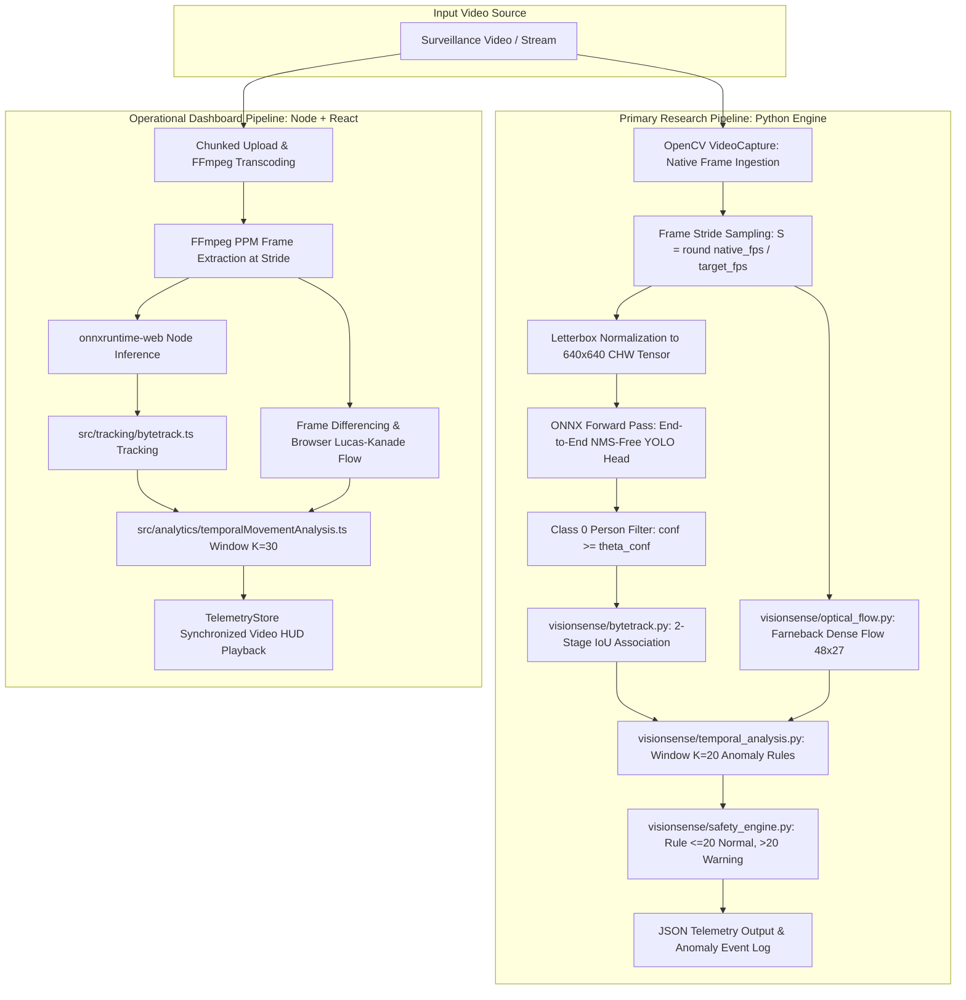

# VisionSense AI Crowd Anomaly Detection System
## Methodology, Mathematical Formulation & System Architecture (Revised)

**Target Publication**: IEEE Transactions / Conference  
**Domain**: Computer Vision, Intelligent Video Surveillance, Crowd Dynamics, Edge AI  
**Basis**: Mathematical extraction directly from active source code in `d:\spidy\YOLO`

---

## 1. System Architecture & Recommended Primary Pipeline

### 1.1 Architectural Scope & Implementation Separation
The VisionSense repository contains two distinct implementations:
1. **Primary Research Implementation (Python Standalone Engine, `visionsense/`)**: Designed for standardized algorithmic execution, batch evaluation, and reproducibility on edge servers. This is the **recommended primary implementation** for reporting algorithmic methodology, tracking benchmarks, and anomaly metrics in an IEEE paper.
2. **Operational Deployment Implementation (Full-Stack TypeScript / React, `server.ts` + `src/`)**: Designed as an interactive Security Operations Center (SOC) dashboard providing synchronized telemetry visualization, chunked video ingestion, and virtual tripwires.

Because their motion estimation methods, temporal window sizes, and cooldown periods differ, **their formulations are documented separately below and must not be conflated**.

---

## 2. Phase 1: Input Preprocessing & Frame Decoupling

Surveillance cameras produce native streams at $25$ to $60$ FPS. Running deep neural networks on every raw frame incurs prohibitive computational cost and redundant latency.

### 2.1 Adaptive Stride Selection
Let $f_{\text{native}}$ denote the native stream frame rate and $f_{\text{target}}$ denote the target inference stride (default: $4.0 - 8.0\text{ Hz}$). The frame stride step $S \in \mathbb{N}^+$ is:
$$S = \max\left(1, \left\lfloor \frac{f_{\text{native}}}{f_{\text{target}}} + 0.5 \right\rfloor\right)$$
Frames are sampled at indices $k \cdot S$, decoupling playback from deep neural inference.

### 2.2 Aspect-Ratio Preserving Letterbox Transformation
Given an input frame $\mathbf{I}_{\text{orig}} \in \mathbb{R}^{H \times W \times 3}$, it is transformed to the network dimension $W_{\text{net}} \times H_{\text{net}} = 640 \times 640$ without geometric distortion:
$$s = \min\left(\frac{W_{\text{net}}}{W}, \frac{H_{\text{net}}}{H}\right)$$
Scaled dimensions:
$$W_s = \lfloor W \cdot s \rceil, \quad H_s = \lfloor H \cdot s \rceil$$
Centered padding offsets:
$$\Delta x = \frac{W_{\text{net}} - W_s}{2}, \quad \Delta y = \frac{H_{\text{net}} - H_s}{2}$$
Normalized planar tensor:
$$\mathbf{X}_{\text{tensor}}(c, y, x) = \frac{\mathbf{I}_{\text{letterbox}}(y, x, c)}{255.0}, \quad c \in \{0, 1, 2\}$$
yielding $\mathbf{X}_{\text{tensor}} \in \mathbb{R}^{1 \times 3 \times 640 \times 640}$ (`float32`).

---

## 3. Phase 2: End-to-End Person Detection

### 3.1 NMS-Free Detection Architecture
The model (`public/models/yolo26n.onnx`) uses an **End-to-End NMS-Free YOLO architecture** (topologically identical to YOLOv10-Nano with dual-assignment heads `one2one_cv2` and `one2one_cv3`). It directly emits a fixed set of $Q = 300$ prediction queries, eliminating post-processing Non-Maximum Suppression (NMS).

### 3.2 Output Decoding & Class Filtering
The network outputs two tensors:
1. Classification logits: $\mathbf{L} \in \mathbb{R}^{1 \times 300 \times 80}$
2. Normalized bounding boxes: $\mathbf{B} \in \mathbb{R}^{1 \times 300 \times 4}$

For query $q \in \{1, \dots, 300\}$, the logit for the COCO person class ($\text{class\_id} = 0$) is extracted:
$$l_q = \mathbf{L}[0, q, 0]$$
Confidence score via logistic sigmoid activation:
$$\hat{c}_q = \sigma(l_q) = \frac{1}{1 + e^{-l_q}}$$
A candidate detection is accepted if:
$$\hat{c}_q \ge \theta_{\text{conf}}, \quad \text{where } \theta_{\text{conf}} \in [0.25, 0.35]$$
Non-person classes ($1 - 79$) are discarded.

### 3.3 Inverse Coordinate Mapping
Predicted normalized box coordinates $[b_{q,0}, b_{q,1}, b_{q,2}, b_{q,3}]$ define $[c_x^{(640)}, c_y^{(640)}, w^{(640)}, h^{(640)}]$:
$$c_x^{(640)} = 640 \cdot b_{q,0}, \quad c_y^{(640)} = 640 \cdot b_{q,1}$$
$$w^{(640)} = 640 \cdot b_{q,2}, \quad h^{(640)} = 640 \cdot b_{q,3}$$
Removing letterbox padding and projecting back to source frame coordinates:
$$c_x^{\text{orig}} = \frac{c_x^{(640)} - \Delta x}{s}, \quad c_y^{\text{orig}} = \frac{c_y^{(640)} - \Delta y}{s}$$
$$w^{\text{orig}} = \frac{w^{(640)}}{s}, \quad h^{\text{orig}} = \frac{h^{(640)}}{s}$$
Bounding box corners:
$$x_1 = \max\left(0, \min\left(W, \left\lfloor c_x^{\text{orig}} - \frac{w^{\text{orig}}}{2} \right\rceil\right)\right)$$
$$y_1 = \max\left(0, \min\left(H, \left\lfloor c_y^{\text{orig}} - \frac{h^{\text{orig}}}{2} \right\rceil\right)\right)$$
$$x_2 = \max\left(0, \min\left(W, \left\lfloor c_x^{\text{orig}} + \frac{w^{\text{orig}}}{2} \right\rceil\right)\right)$$
$$y_2 = \max\left(0, \min\left(H, \left\lfloor c_y^{\text{orig}} + \frac{h^{\text{orig}}}{2} \right\rceil\right)\right)$$
Degenerate boxes satisfying $x_2 \le x_1 + 4$ or $y_2 \le y_1 + 4$ are discarded.

---

## 4. Phase 3: ByteTrack Multi-Target Association

To track individuals through occlusions, VisionSense applies **ByteTrack** across sampled frames.

### 4.1 State Propagation
Each track $\tau_k$ maintains bounding box state $\mathbf{s}_k = [x_1, y_1, x_2, y_2]^T$ and velocity $\mathbf{v}_k = [v_x, v_y]^T$. Centroid:
$$\mathbf{c}_k = \left[\frac{x_1 + x_2}{2}, \frac{y_1 + y_2}{2}\right]^T$$
In the prediction step:
$$\mathbf{s}_k^{(t|t-1)} = \mathbf{s}_k^{(t-1)} + [v_x, v_y, v_x, v_y]^T$$

### 4.2 Two-Stage IoU Association
Detections $\mathcal{D} = \{d_1, \dots, d_M\}$ are partitioned:
$$\mathcal{D}_{\text{high}} = \{d \in \mathcal{D} \mid \hat{c}_d \ge \theta_{\text{high}}\}, \quad \theta_{\text{high}} = 0.50 \text{ (Python) or } 0.35 \text{ (TS)}$$
$$\mathcal{D}_{\text{low}} = \{d \in \mathcal{D} \mid \theta_{\text{low}} \le \hat{c}_d < \theta_{\text{high}}\}, \quad \theta_{\text{low}} = 0.10 \text{ (Python) or } 0.20 \text{ (TS)}$$

- **Stage 1**: Active tracks $\mathcal{T}_{\text{active}}$ are matched with $\mathcal{D}_{\text{high}}$ using greedy IoU assignment with $\text{IoU} \ge \theta_{\text{match}}$ (default: $0.40$).
- **Stage 2**: Remaining unmatched tracks are matched with $\mathcal{D}_{\text{low}}$ using relaxed threshold $\text{IoU} \ge 0.30$ to recover occluded individuals.
- **Track Lifecycle**: Unmatched $\mathcal{D}_{\text{high}}$ spawn $\text{NEW}$ tracks. Tracks with $\ge 2$ updates become $\text{TRACKED}$. Tracks missing for $> 2$ frames become $\text{LOST}$; tracks missing for $> 25$ frames are $\text{REMOVED}$.

### 4.3 Velocity Smoothing
Centroid velocity is smoothed via exponential moving average ($\alpha = 0.6$):
$$\mathbf{v}_k^{(t)} = \alpha \left(\mathbf{c}_k^{(t)} - \mathbf{c}_k^{(t-1)}\right) + (1 - \alpha) \mathbf{v}_k^{(t-1)}$$
Scalar speed:
$$\|\mathbf{v}_k\| = \sqrt{v_{x,k}^2 + v_{y,k}^2}$$

---

## 5. Phase 4: Motion Estimation Formulations (Distinct Algorithms)

The repository implements three distinct motion estimation methods across its components:

### 5.1 Python Engine: Dense Farneback Optical Flow (`visionsense/optical_flow.py`)
Used in the recommended Python research pipeline:
1. Grayscale frames are downsampled to $48 \times 27$ pixels.
2. Dense displacement field $(f_x, f_y)$ is computed via `cv2.calcOpticalFlowFarneback`.
3. Converted to polar magnitude and angle:
   $$\rho(x, y) = \sqrt{f_x^2 + f_y^2}, \quad \theta(x, y) = \text{atan2}(f_y, f_x)$$
4. Active motion mask: $\mathcal{M} = \{(x, y) \mid \rho(x, y) > 0.4\}$.
5. Active density factor:
   $$\delta_{\text{active}} = \frac{|\mathcal{M}|}{48 \cdot 27}$$
6. Directional dispersion (measuring crowd disorder vs. uniform flow):
   $$\sigma_\theta = \text{std}(\{\theta(x, y) \mid (x, y) \in \mathcal{M}\})$$
7. Composite motion score:
   $$S_{\text{motion}} = \min\left(1.0, 0.7 \cdot \frac{\bar{\rho}}{5.0} + 0.3 \cdot \delta_{\text{active}}\right)$$

### 5.2 TypeScript Frontend: Regularized Lucas-Kanade Flow (`src/cv/denseOpticalFlow.ts`)
Used in browser canvas overlay:
1. Evaluated on $320 \times 180$ luminance map with grid step $G = 24\text{ px}$.
2. Spatio-temporal gradients: $I_x, I_y, I_t$.
3. Over a $(2W+1) \times (2W+1)$ window ($W = 3$), the Tikhonov-regularized system ($\lambda = 4.0$) is solved:
   $$\begin{bmatrix} S_{xx} + \lambda & S_{xy} \\ S_{xy} & S_{yy} + \lambda \end{bmatrix} \begin{bmatrix} u \\ v \end{bmatrix} = \begin{bmatrix} -S_{xt} \\ -S_{yt} \end{bmatrix}$$
   $$u = \frac{S_{xy} S_{yt} - (S_{yy} + \lambda) S_{xt}}{\text{det}}, \quad v = \frac{S_{xy} S_{xt} - (S_{xx} + \lambda) S_{yt}}{\text{det}}$$
   where $\text{det} = (S_{xx} + \lambda)(S_{yy} + \lambda) - S_{xy}^2$.
4. Vectors with magnitude $M = \sqrt{u^2 + v^2} > 0.3$ are retained:
   $$S_{\text{motion}} = \min\left(1.0, \frac{\bar{M}}{12.0}\right)$$

### 5.3 TypeScript Server: Luminance Frame Differencing (`src/server/videoAnalyzer.ts`)
Used during server-side batch video analysis:
1. Samples every 8th pixel on $640 \times 640$ raw RGB buffer.
2. Sums absolute luminance differences:
   $$\Delta Y = \sum_{p} |Y_t(p) - Y_{t-1}(p)|$$
   $$S_{\text{flow}} = \min\left(1.0, \frac{\Delta Y}{N_{\text{samples}} \cdot 45}\right)$$
3. Blends with average tracker speed:
   $$S_{\text{motion}} = \min\left(1.0, 0.5 \cdot S_{\text{flow}} + 0.5 \cdot \min\left(1.0, \frac{\bar{v}_{\text{track}}}{200}\right)\right)$$

---

## 6. Phase 5: Temporal Movement Anomaly Engine

Maintains a sliding history window $\mathcal{W}_t$ over the preceding $K$ sampled frames:
$$\mathcal{W}_t = \left\{ r_{t - K + 1}, \dots, r_t \right\}$$
where $K = 20$ in Python (`visionsense/temporal_analysis.py`) and $K = 30$ in TypeScript (`src/analytics/temporalMovementAnalysis.ts`).

### 6.1 Anomaly Classifiers

#### 1. Sudden Crowd Surge / Acceleration Jump
Detects sudden crowd acceleration:
$$\Delta \mu_{\text{mag}} = \frac{1}{5} \sum_{i=0}^4 \bar{\rho}_{t-i} - \frac{1}{K-5} \sum_{i=5}^{K-1} \bar{\rho}_{t-i}$$
If $\Delta \mu_{\text{mag}} > 2.5$ and $N_t > 5$:
$$S_{\text{unusual}} = \min\left(1.0, 0.4 + 0.12 \cdot \Delta \mu_{\text{mag}}\right), \quad \text{Label: "Sudden Crowd Surge"}$$

#### 2. Rapid Dispersal Pattern
Detects rapid crowd scattering or evacuation:
$$\Delta N = N_t - N_{t - K + 1}$$
If $\Delta N < -8$ and $\bar{S}_{\text{motion}} > 0.40$:
$$S_{\text{unusual}} = \min\left(1.0, 0.5 + 0.05 \cdot |\Delta N|\right), \quad \text{Label: "Rapid Dispersal"}$$

#### 3. Bottleneck Stagnation
Detects high-density blockages with near-zero movement:
If $N_t > 15$ and $\bar{S}_{\text{motion}} < 0.05$:
$$S_{\text{unusual}} = \min\left(1.0, 0.3 + \frac{N_t}{60.0}\right), \quad \text{Label: "Bottleneck Stagnation"}$$

#### 4. Baseline Flow
In ambient conditions:
$$S_{\text{unusual}} = 0.4 \cdot \bar{S}_{\text{motion}}$$

### 6.2 Debouncing via Persistence Counter
To prevent transient spikes from triggering false alarms:
$$C_{\text{pers}}^{(t)} = \begin{cases} C_{\text{pers}}^{(t-1)} + 1, & \text{if } S_{\text{unusual}} > 0.65 \\ \max\left(0, C_{\text{pers}}^{(t-1)} - 1\right), & \text{otherwise} \end{cases}$$
An anomaly is formally declared when:
$$\text{AnomalyConfirmed} = \mathbf{1}\left(C_{\text{pers}}^{(t)} \ge 3 \ \land \ S_{\text{unusual}} > 0.65\right)$$

---

## 7. Phase 6: Crowd Safety Engine & Alert Generation

### 7.1 Exact Crowd Safety Rule
Surveillance density boundaries:
$$\text{Status}(t) = \begin{cases} \text{NORMAL (Green)}, & \text{if } N_t \le 20 \\ \text{WARNING (Amber)}, & \text{if } N_t > 20 \end{cases}$$
Debounce requires candidate status to hold for $3$ consecutive frames (Python) or $5$ frames (TypeScript) to transition confirmed status.

### 7.2 Throttled Alert Dispatch
To mitigate alert fatigue, alerts enforce a refractory cooldown:
$$\tau_{\text{cooldown}} = 5.0\text{ seconds (Python)} \quad \text{or} \quad 3.0\text{ seconds (TypeScript)}$$
An alert is dispatched if:
$$(t - t_{\text{last\_alert}} \ge \tau_{\text{cooldown}}) \land (\text{Status}(t) = \text{WARNING} \lor \text{AnomalyConfirmed} = \text{True})$$

---

## 8. Theoretical Computational Complexity (Estimated)

| Pipeline Stage | Algorithmic Mechanism | Time Complexity per Frame | Space Complexity |
| :--- | :--- | :--- | :--- |
| **Stride Sampling** | Modulo index | $O(1)$ | $O(1)$ |
| **Letterboxing** | Bilinear resize + pad | $O(W \cdot H)$ | $O(W_{\text{net}} \cdot H_{\text{net}})$ |
| **NMS-Free YOLO** | CNN backbone + one2one head | $O(\text{FLOPs}_{\text{model}}) \approx 8.2 - 8.5\text{ GFLOPs (Est.)}$ | $2,434,188\text{ parameters}$ |
| **Query Filtering** | Scan $Q=300$ queries | $O(Q) = O(300)$ | $O(Q)$ |
| **ByteTrack Stage 1** | Greedy IoU matching | $O(|\mathcal{T}| \cdot |\mathcal{D}_{\text{high}}| \log(|\mathcal{T}| \cdot |\mathcal{D}_{\text{high}}|))$ | $O(|\mathcal{T}| \cdot |\mathcal{D}|)$ |
| **ByteTrack Stage 2** | Low-conf IoU matching | $O(|\mathcal{T}_{\text{rem}}| \cdot |\mathcal{D}_{\text{low}}|)$ | $O(|\mathcal{T}| \cdot |\mathcal{D}|)$ |
| **Farneback Flow** | $48 \times 27$ polynomial expansion | $O(48 \cdot 27 \cdot k_{\text{poly}}) \approx 1300\text{ ops}$ | $O(48 \cdot 27)$ |
| **Temporal Engine** | Rolling window update | $O(K) \approx O(20)$ | $O(K)$ |
| **Total Pipeline** | End-to-end sampled execution | Dominated by CNN Forward Pass | $< 150 \text{ MB RAM}$ |
