# VisionSense AI Crowd Anomaly Detection System
## Model Architecture, Runtime Infrastructure & Computational Profiling (Revised)

**Target Publication**: IEEE Conference / Journal  
**Domain**: Edge AI, Real-Time Inference, Embedded Video Surveillance  
**Basis**: Protobuf Graph & Initializer Verification on `public/models/yolo26n.onnx`

---

## 1. Verified Model Specifications

### 1.1 Primary Detection Neural Network (`public/models/yolo26n.onnx`)

| Parameter | Verifiable Specification | Verification Source / Method |
| :--- | :--- | :--- |
| **Model Filename** | `yolo26n.onnx` | Stored at `d:\spidy\YOLO\public\models\yolo26n.onnx` |
| **Model File Size** | **9,890,454 bytes** (9.432 MiB / 9.43 MB) | Direct filesystem audit (`os.path.getsize`) |
| **Export Framework** | PyTorch 2.9.1 (ONNX IR Version 8, Opset 17) | Protobuf header decoding (Field 3: `pytorch 2.9.1`, Field 1: `8`) |
| **Metadata Provenance** | **No author or brand metadata strings** present | Full scan of Protobuf `metadata_props` |
| **Graph Topology** | **End-to-End NMS-Free YOLO** | Verified node names: `one2one_cv2`, `one2one_cv3`, `model.10.m.m.0.attn` |
| **Exact Parameter Count** | **2,434,188 parameters** ($2.434\text{ M}$) | Parsed from all 231 `initializer` tensor dimensions in ONNX Protobuf |
| **Total Initializer Tensors** | **231 tensors** | Directly enumerated from ONNX `GraphProto.initializer` |
| **GFLOPs** | **Unverified / Theoretical estimate ($\sim 8.2 - 8.5\text{ GFLOPs}$)** | Estimated based on YOLOv10-Nano topology at $640 \times 640$; tool profiling pending |
| **Input Tensor Name** | `pixel_values` | Verified from `GraphProto.input` |
| **Input Tensor Shape** | $[1, 3, 640, 640]$ | In-code allocation (`Float32Array(3 * 640 * 640)`) |
| **Input Data Format** | Planar CHW, Normalized RGB $[0.0, 1.0]$ | In-code normalization (`val / 255.0`) |
| **Output Tensor 1** | `logits` $\in \mathbb{R}^{1 \times 300 \times 80}$ (`float32`) | Pre-sigmoid class logits for 80 COCO categories |
| **Output Tensor 2** | `pred_boxes` $\in \mathbb{R}^{1 \times 300 \times 4}$ (`float32`) | Normalized center coordinates & dimensions $[c_x, c_y, w, h]$ |
| **Candidate Queries ($Q$)** | $300$ prediction queries per frame | Fixed length query dimension ($Q = 300$) |
| **Target Filtering** | Strictly Class 0 (`class_id: 0`, `"person"`) | Hardcoded in `visionsense/detector.py` and `videoAnalyzer.ts` |
| **Post-Processing NMS** | **None (NMS-Free End-to-End)** | End-to-End one-to-one matching architecture |

### 1.2 Fallback Client-Side Detector (`@tensorflow-models/coco-ssd`)

| Parameter | Specification | Verification Source / Method |
| :--- | :--- | :--- |
| **Model Package** | `@tensorflow-models/coco-ssd` v2.2.3 | Listed in `package.json` |
| **Backbone Architecture** | MobileNetV2 SSDLite | Configured in `yoloDetector.ts` (`base: 'mobilenet_v2'`) |
| **Target Class** | Filtered strictly for `"person"` | In-code filter in `cocoSsdFallbackDetector.ts` |
| **Runtime Status** | **Implemented but runtime validation pending** | Test script `test_yolo.js` failed: package not installed |

---

## 2. Hardware Environment & Runtime Infrastructure

### 2.1 Host Environment
- **Operating System**: Microsoft Windows 11 Home / Pro (64-bit AMD64)
- **CPU Architecture**: x86_64 Multi-Core Processor
- **Python Version**: Python 3.13.1 (Dec 3 2024, tags/v3.13.1:0671451)
- **Node.js Version**: Node.js v22.14.0

### 2.2 Current Software Environment Gaps
Runtime execution of deep learning inference and video transcoding is currently blocked by the following missing prerequisites:
- **Python 3.13 packages missing**: `opencv-python-headless`, `torch`, `ultralytics`, `onnxruntime`.
- **Node.js packages missing**: `node_modules` directory has not been installed (`npm list --depth=0` returns unmet dependencies).
- **System multimedia tools missing**: `ffmpeg` and `ffprobe` are not recognized in system PATH.
- **Physical video assets missing**: Zero `.mp4` video files are present in the repository.

---

## 3. Theoretical Latency Budget vs. Empirical Status

To ensure complete academic transparency, **all latency and frame-rate figures in this section are theoretical design estimates**. Empirical benchmarking remains pending controlled hardware execution.

### 3.1 Theoretical Latency Budget per Sampled Frame (Estimated)

```mermaid
gantt
    title Sampled Frame Latency Budget (Single-Threaded CPU Design Estimate)
    dateFormat X
    axisFormat %s ms
    section Preprocessing
    Letterbox & RGB Normalize : 0, 8
    section Deep Inference
    ONNX Forward Pass (YOLOv10-N) : 8, 55
    section Tracking
    ByteTrack Kalman & IoU : 55, 60
    section Motion
    Dense Optical Flow (Grid) : 60, 68
    section Anomaly
    Temporal Engine & Alerts : 68, 70
```

| Pipeline Step | Mathematical Operation | Theoretical Operation Count | Estimated Latency on Standard CPU |
| :--- | :--- | :--- | :--- |
| **Preprocessing ($t_{\text{prep}}$)** | Bilinear interpolation to $640 \times 640$, planar RGB normalization | $\approx 1.23 \times 10^6$ multiply-adds | $5 - 10\text{ ms}$ (Estimate) |
| **Neural Forward Pass ($t_{\text{infer}}$)** | ONNX Runtime evaluation on `pixel_values` $\to$ `logits`, `pred_boxes` | $\approx 8.2 - 8.5\text{ GFLOPs}$ | $35 - 65\text{ ms}$ (Estimate) |
| **Detection Filtering ($t_{\text{filter}}$)** | Linear scan of $Q=300$ queries, sigmoid activation, inverse letterbox | $\approx 1,200$ scalar operations | $< 0.5\text{ ms}$ (Estimate) |
| **ByteTrack Tracking ($t_{\text{track}}$)** | Kalman/linear velocity propagation, 2-stage greedy IoU matching | $< 2,500$ pairwise IoU comparisons | $2 - 5\text{ ms}$ (Estimate) |
| **Motion Estimation ($t_{\text{flow}}$)** | Regularized Lucas-Kanade on 24px grid ($320 \times 180$) or Farneback on $48 \times 27$ | $\approx 72$ window evaluations ($7 \times 7$) | $5 - 10\text{ ms}$ (Estimate) |
| **Temporal Engine ($t_{\text{temp}}$)** | Rolling window delta, magnitude jump, persistence accumulator | $< 100$ scalar operations | $< 0.5\text{ ms}$ (Estimate) |
| **Total Estimated Frame Time ($T_{\text{frame}}$)** | Cumulative execution per sampled frame on CPU | - | **$47.5 - 91.0\text{ ms}$ (Estimate)** |
| **Estimated Peak CPU Throughput** | $1000 / T_{\text{frame}}$ | - | **$11 - 21\text{ FPS}$ (Theoretical Estimate)** |

### 3.2 End-to-End Alert Dispatch Latency (Estimated)
At an adaptive inference stride of $f_{\text{target}} = 4.0 - 8.0\text{ Hz}$:
1. **Frame Ingestion to Anomaly Calculation**: $T_{\text{frame}} \approx 60\text{ ms}$ (estimated).
2. **Debounce Confirmation Delay**: Requires $C_{\text{pers}} \ge 3$ consecutive frames:
   $$\text{Debounce Delay} = 3 \times \frac{1}{f_{\text{target}}} \approx 375 - 750\text{ ms}$$
3. **UI Dispatch & Display Render**: $\approx 16 - 33\text{ ms}$.
4. **Estimated End-to-End Alert Latency**:
   $$L_{\text{alert}} \approx 450 - 850\text{ ms} \quad \text{(Theoretical Estimate, Pending Empirical Verification)}$$

---

## 4. Separation of Verified Facts from Pending Measurements

| Metric | Scientific Status | Evidence / Notes |
| :--- | :--- | :--- |
| **Model File Size** | **Verified Fact** | 9,890,454 bytes on disk |
| **Exact Parameters** | **Verified Fact** | 2,434,188 parameters parsed from 231 ONNX initializers |
| **Input/Output Shapes** | **Verified Fact** | `[1,3,640,640]` $\to$ `[1,300,80]`, `[1,300,4]` parsed from protobuf |
| **GFLOPs** | **Theoretical Estimate (Unverified)** | Estimated $\sim 8.2 - 8.5\text{ GFLOPs}$, pending dynamic tool profiling |
| **Frame Latency ($T_{\text{frame}}$)** | **Pending controlled experiment** | Theoretical estimate: $47.5 - 91.0\text{ ms}$; empirical measurement pending |
| **Pipeline Throughput (FPS)** | **Pending controlled experiment** | Theoretical estimate: $11 - 21\text{ FPS}$; empirical measurement pending |
| **Alert Latency ($L_{\text{alert}}$)** | **Pending controlled experiment** | Theoretical estimate: $< 850\text{ ms}$; empirical measurement pending |
| **Peak Memory Consumption** | **Pending controlled experiment** | Estimated $< 150\text{ MB}$; empirical profiling pending application execution |
| **Detection Accuracy (mAP)** | **Pending controlled experiment** | Requires evaluation on COCO or surveillance datasets |
| **Tracking Accuracy (MOTA/IDF1)** | **Pending controlled experiment** | Requires evaluation on MOT17/MOT20 benchmarks |
| **Anomaly Accuracy (ROC-AUC/EER)** | **Pending controlled experiment** | Requires evaluation on UCSD Ped2 or ShanghaiTech benchmarks |
