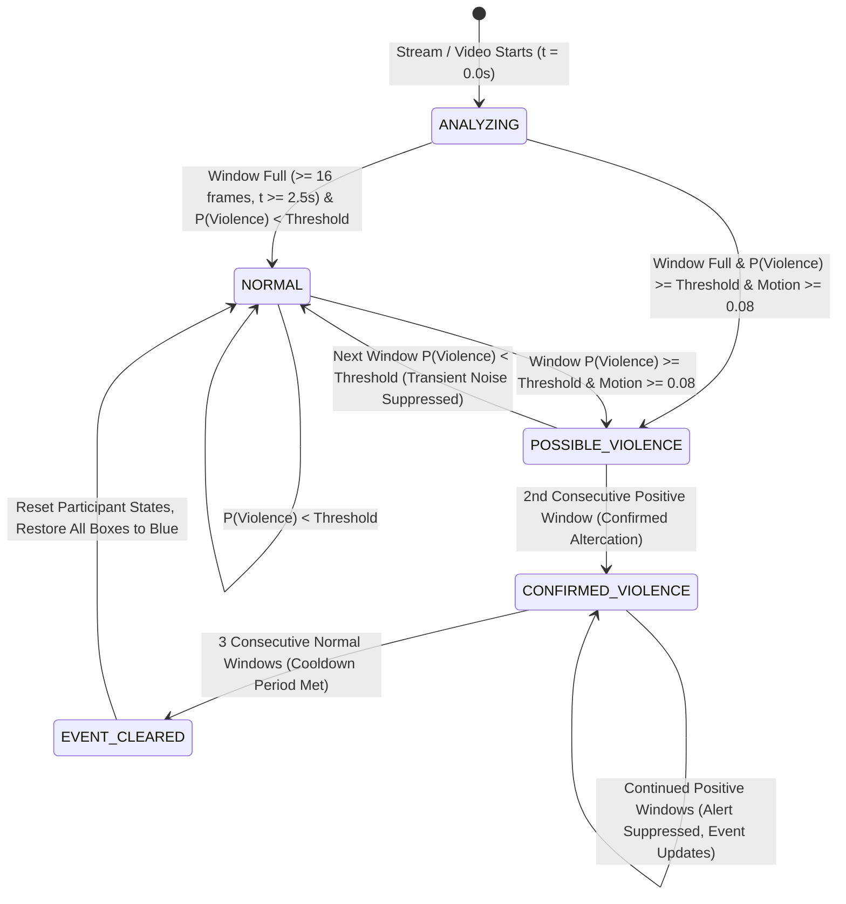

# VisionSense AI — Violence Event State Machine & Participant Tracking Design

**Document ID:** VS-ARCH-2026-VET  
**Author:** VisionSense Computer Vision & Distributed Systems Architecture Team  
**Scope:** Spatio-temporal event states, temporal accumulation, debounce/hysteresis, and evidence-based participant track association.

---

## 1. Five-Stage Finite State Machine (FSM)

To prevent premature alerts, static frame artifacts, and alert flickering, the violence detection engine enforces a five-stage state transition protocol:

### State Specifications

| State | Temporal Condition | UI Banner Display | Bounding Box Color | Action Status Meter |
| :--- | :--- | :--- | :--- | :--- |
| **`ANALYZING`** | Frames $< 16$ or temporal span $< 2.5\text{s}$ | `ANALYZING TEMPORAL BUFFER...` | **BLUE** (`#00f0ff`) | `ANALYZING (0–100% Buffer)` |
| **`NORMAL`** | Window full, $P < \theta$, Motion normal | `NORMAL SURVEILLANCE` | **BLUE** (`#00f0ff`) | `SECURE / NORMAL` |
| **`POSSIBLE_VIOLENCE`** | 1 positive window ($P \ge \theta$, Motion $\ge 0.08$) | `MONITORING SUSPICION` | **BLUE** (`#00f0ff`) | `SUSPECTED (Evaluating)` |
| **`CONFIRMED_VIOLENCE`** | 2 consecutive positive windows ($N \ge 2$) | `🚨 CRITICAL VIOLENCE DETECTED` | **RED** (`#ef4444`) for participants; **BLUE** for bystanders | `CRITICAL (Active Event)` |
| **`EVENT_CLEARED`** | 3 consecutive normal windows ($K \ge 3$) | `INCIDENT RESOLVED` | **BLUE** (`#00f0ff`) | `CLEARED (Restoring)` |

---

## 2. Kinetic Optical Flow Gating

Because 3D CNN backbones can exhibit out-of-distribution bias on stationary images (e.g. wood paneling, static human poses), the system applies **Kinetic Gating**:
- **Formula:** 
  $$\text{Effective Confidence} = \begin{cases} P(\text{Violence}), & \text{if } \text{Motion Score} \ge 0.06 \\ P(\text{Violence}) \times \frac{\text{Motion Score}}{0.06}, & \text{if } \text{Motion Score} < 0.06 \end{cases}$$
- If optical flow across the scene is near zero (stationary scene, people standing peacefully reading phones), static activations are suppressed.
- A physical fight requires active kinetic displacement.

---

## 3. Evidence-Based Participant Track Association

When `CONFIRMED_VIOLENCE` is asserted, individual tracked people are evaluated for active participation:

### Criteria for Participant Classification (RED)
1. **Spatial Proximity & Bounding Box Overlap:**
   - For all active track pairs $(A, B)$, compute the Euclidean distance between centroids:
     $$d(A, B) = \sqrt{(c_{x,A} - c_{x,B})^2 + (c_{y,A} - c_{y,B})^2}$$
   - Normalized by maximum bounding box height $H = \max(h_A, h_B)$.
   - If $d(A, B) \le 1.25 \times H$ or $\text{IoU}(A, B) > 0.05$ (or boxes touch within 20px), tracks $A$ and $B$ are classified as in physical contact range.
2. **Kinetic Perturbation:**
   - The track exhibits acceleration, non-linear velocity change, or speed $\ge 25\text{ px/sec}$ during the contact window.
3. **Participant Annotation:**
   - Marked tracks receive:
     - `is_violence_participant: true`
     - Bounding Box Outline: Crimson Red (`#ef4444`)
     - Semi-transparent fill: `rgba(239, 68, 68, 0.15)`
     - Comic Pill Badge: `VIOLENCE EVENT PARTICIPANT`
4. **Bystander Protection (BLUE):**
   - Tracked individuals outside the interaction radius ($d > 1.5 \times H$, no intersection) remain strictly **BLUE** (`#00f0ff`).

### Automatic Restoration to BLUE
When the state transitions from `CONFIRMED_VIOLENCE` through `EVENT_CLEARED` to `NORMAL`:
- All participant flags are set to `false`.
- All bounding boxes immediately and automatically return to standard **BLUE**.
- No stale participant flags persist when track IDs are reassigned.

---

## 4. Video & Session Reset Protocol

When an operator uploads a new video, switches CCTV camera feeds, or resets playback:
1. `frame_buffer.clear()` and `time_buffer.clear()`
2. `consecutive_violent_windows = 0`
3. `consecutive_normal_windows = 0`
4. `active_state = "ANALYZING"`
5. `active_participants.clear()`
6. `last_event_id = null`
No stale alerts or red boxes leak into new sessions.
